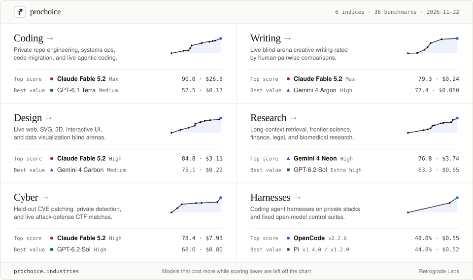

# ProChoice

Open-source LLM leaderboard and coding agent harness benchmark by [Retrograde Labs](https://inretrograde.io). Compare frontier language models by composite score and real dollar cost across six task domains, with dominated configurations cut from the chart.

**Live site:** [prochoice.industries](https://prochoice.industries)

[](https://github.com/RetrogradeLabs/pro-choice/actions/workflows/ci.yml)
[](https://github.com/RetrogradeLabs/pro-choice/actions/workflows/daily-ingest.yml)
[](LICENSE)
[](https://creativecommons.org/licenses/by/4.0/)

<a href="https://prochoice.industries">
  <picture>
    <source media="(prefers-color-scheme: dark)" srcset="docs/assets/index-matrix-dark.svg" />
    <source media="(prefers-color-scheme: light)" srcset="docs/assets/index-matrix-light.svg" />
    
  </picture>
</a>

## Live composite indices

Snapshot `6aa5247f8f563c56`, updated `2026-11-21` from 18 public benchmark and first-party pricing feeds. Default model picks cover the five Western providers shown on initial load; toggle DeepSeek, Moonshot, Alibaba, and Zhipu on [prochoice.industries](https://prochoice.industries) to compare all nine.

| Composite index | Tests in this view | Lowest cost | Value pick | Highest estimate |
| :--- | :---: | :--- | :--- | :--- |
| [Coding](https://prochoice.industries/coding) | 5 | GPT-6 Luna (Low) at 23.4, \$0.0051 · 1/5 benchmarks · 1 feed · 95% interval 4.3 to 42.5 | No supported pick | Claude Sonnet 5.5 (Max) at 79.5, \$10.0 · 3/5 benchmarks · 3 feeds · 95% interval 69.7 to 89.2 |
| [Writing](https://prochoice.industries/writing) | 4 | Gemini 3.5 Flash-Lite (Minimal) at 47.8, \$0.013 · 1/4 benchmarks · 1 feed · 95% interval 34.3 to 61.3 | No supported pick | Gemini 3.7 Flash (Medium) at 58.0, \$0.022 · 1/4 benchmarks · 1 feed · 95% interval 44.5 to 71.5 |
| [Design](https://prochoice.industries/design) | 4 | Grok 4.3 (Low) at 26.7, \$0.014 · 2/4 benchmarks · 2 feeds · 95% interval 13.0 to 40.5 | GPT-6.1 Sol (Max) at 63.5, \$0.27 · 3/4 benchmarks · 3 feeds · 95% interval 47.8 to 79.2 | Claude Sonnet 5.5 (Extra high) at 69.8, \$3.56 · 1/4 benchmarks · 1 feed · 95% interval 60.5 to 79.1 |
| [Research](https://prochoice.industries/research) | 10 | GPT-6 Luna (Low) at 36.8, \$0.0051 · 3/10 benchmarks · 1 feed · 95% interval 25.2 to 48.4 | No supported pick | GPT-6.2 Astra (Extra high) at 71.3, \$2.52 · 4/10 benchmarks · 1 feed · 95% interval 59.5 to 83.1 |
| [Cyber](https://prochoice.industries/cyber) | 2 | GPT-6.1 Terra (High) at 53.1, \$3.76 · 1/2 benchmarks · 1 feed · 95% interval 44.7 to 61.6 | No supported pick | Claude Fable 5.2 (High) at 73.6, \$67.0 · 1/2 benchmarks · 1 feed · 95% interval 66.1 to 81.1 |
| [Harnesses](https://prochoice.industries/harnesses) | 1 | Oh My Pi at 16.8% (95% interval 7.7 to 25.8%), \$1.10 | Codex CLI at 18.2% (95% interval 8.1 to 28.4%), \$1.11 | Hermes Agent at 20.0% (95% interval 9.9 to 30.1%), \$1.34 |

The Harnesses row shows the default Terminal-Bench 4.0 comparison. Its middle entry describes a cost–score tradeoff. Select DeepSWE on the site for the separate repository-task board.

## Why ProChoice

Most public AI leaderboards scatter scores across dozens of incompatible scales, omit real dollar task cost, average together different reasoning effort levels, or mix coding agent scaffolding into raw model rankings. Picking a model for real production traffic turns into guesswork.

ProChoice fixes those four gaps directly:

- **One monotonic frontier per provider.** Models and reasoning efforts that cost more while scoring lower drop off the default chart and move into the Pruned table with exact wasted cost multiples.
- **Six separated tracks.** Coding, Writing, Design, Research, Cyber, and Harnesses never collapse into one arbitrary overall average. Cross-domain Kendall tau correlations appear in every daily lifecycle audit.
- **Explicit reasoning effort tiers.** Every configuration resolves to a verified first-party API reasoning effort tier. Scores never copy across effort tiers, and costs never copy across distinct harnesses.
- **Controlled coding agent harness results.** Select Terminal-Bench 4.0 or DeepSWE, then a control model. Each comparison uses the selected task set's pass rate, confidence interval and cost per run. The model-plus-harness index separately measures repository implementation and comprehension.

## Public API and AI agents

ProChoice publishes unauthenticated, read-only JSON and Markdown endpoints under [prochoice.industries/docs](https://prochoice.industries/docs) with strong `ETag` headers for conditional `304 Not Modified` polling.

```bash
# Fetch the Coding Pareto frontier as typed JSON
curl -sS https://prochoice.industries/api/v1/domains/coding

# Fetch the full snapshot and lifecycle audit across all six domains
curl -sS https://prochoice.industries/api/v1/snapshot

# Request compact Markdown directly from any route
curl -sS -H "Accept: text/markdown" https://prochoice.industries/coding

# Read the agent directory, full Markdown compendium, or OpenAPI 3.1 schema
curl -sS https://prochoice.industries/llms.txt
curl -sS https://prochoice.industries/llms-full.txt
curl -sS https://prochoice.industries/openapi.json
```

Machine-readable discovery also ships at `/.well-known/api-catalog`, `/sitemap.xml`, and static Markdown aliases `/coding.md` through `/harnesses.md`.

## Methodology

The [model-card review](docs/coverage/model-cards.md), [coding and research audit](docs/coverage/coding-research.md), [writing and design audit](docs/coverage/writing-design.md), and [harness and security audit](docs/coverage/harnesses-security.md) record what each index measures, which sources qualified, and why other results were excluded. The Methodology panel shows how many configurations have scores for each benchmark and how the ranking changes when a feed is removed.

The [Sophon catalog review](docs/coverage/sophon.md) records the search across 630 entries and the decisions about overlapping tasks. The [professional task review](docs/coverage/professional-tasks.md) covers clinical documentation, repository migration, legal retrieval and financial analysis. The [decision policy](docs/coverage/decision-policy.md) separates the highest numerical estimate from an endorsed winner. The [rank audit](docs/coverage/rank-evidence.md) compares predictions with results held out of calibration. The [release review](docs/coverage/release-review.md) records the panel’s decisions and remaining evidence limits.

Every daily pipeline run executes the same deterministic psychometric and economic pipeline from raw cached upstream feeds:

1. **Nine-provider allowlist.** Model leaderboards rank Anthropic, OpenAI, Google, SpaceXAI, Meta, DeepSeek, Moonshot, Alibaba, and Zhipu only, resolved through strict token-bounded aliases in `src/config/aliases.json`.
2. **Task family weights.** In Coding, Writing, Design and Research v3 and the software engineering stack index v2, distinct task families receive equal total weight. The release admits one scored instrument per distinct task and checks dataset lineage for reused cases. Frozen diagnostic quality weights and refits that hold out entire feeds make that policy inspectable. [Weight comparison](docs/coverage/measurement-families.md)
3. **Equal-1.0 anchor standardization and REML Empirical Bayes pooling.** Raw scores align via provider-balanced anchor standardization, Kolen and Brennan Mean-Sigma overlap linking with joint-jackknife uncertainty, weighted two-way linear Rasch equating, and heteroscedastic REML Empirical Bayes shrinkage with a `B >= 0.50` eligibility floor.
4. **Homogeneous cost axis and correlated Pareto bootstraps.** Missing task costs for non-retired models with verified first-party public API pricing are estimated on the domain's homogeneous cost axis through joint OLS plus isotonic effort-ladder regression. Log-normal cost uncertainty propagates through 10,000 correlated Monte Carlo draws to estimate frontier membership and knee probabilities.
5. **Automated saturation retirement.** Daily CI computes Akhtar et al. ICML 2026 saturation indices, Arena-Hard 95% CI pairwise separability, leave-one-out composite rank stability, and 14-day sustained trigger checks inside immutable semantic MAJOR domain epochs under `data/epochs/`.

## Local development

Requires Bun `1.4.x`, plus Node.js `26` LTS for cross-runtime validation parity.

```bash
git clone https://github.com/RetrogradeLabs/pro-choice.git
cd pro-choice
bun install --frozen-lockfile
cp .env.example .env.local
bun run dev
```

Open `http://localhost:3000`. The app uses Next.js 16.4 App Router with React 19.3, React Compiler, `cacheComponents`, Tailwind CSS v4 Oxide, `@base-ui/react`, `motion/react`, and `d3-scale`.

### Run the full ingestion and verification pipeline

```bash
bun run sync
bun run verify
```

`bun run sync` runs three stages in order:

1. `bun run ingest` fetches the mandatory upstream feeds, updates per-benchmark partitions under `data/raw/`, computes Rasch scores, Empirical Bayes shrinkage, monotone effort cost estimates, and bootstrap Pareto probabilities, and writes `data/snapshot.json`, `data/epochs/*.json`, and `data/unmapped.json`.
2. `bun run audit:lifecycle` computes daily saturation indices, pairwise separability, leave-one-out stability, and cross-domain correlations into `data/lifecycle.json`.
3. `bun run validate:snapshot` verifies schema validity, canonical hash match, immutable MAJOR epoch baselines, full raw-to-release recomputation, and source freshness.

`bun run verify` runs Biome v2, Oxlint with `--deny-warnings`, ESLint 10, `next typegen` plus strict TypeScript `tsc --noEmit`, and the Next.js production build.

### Environment variables

See [`.env.example`](.env.example):

- `HF_TOKEN`: Optional Hugging Face read token to avoid anonymous rate limits when downloading `lmarena-ai/leaderboard-dataset` Parquet files.
- `STRICT_FRESHNESS`: Set to `1` in CI to fail the pipeline if any mandatory adapter stays degraded for more than 7 consecutive days.

## Repository layout

| Path | Responsibility |
| :--- | :--- |
| `src/app/` | Next.js 16 App Router pages, static domain routes, OpenGraph cards, `/api/v1/*`, `/llms.txt`, and `/openapi.json` |
| `src/components/` | Pareto SVG charts, verdict placards, multi-row tables, harness tabs, and methodology monograph drawer |
| `src/config/` | Provider allowlist, benchmark definitions, effort defaults, and strict model aliases |
| `src/lib/math/` | Anchor standardization, linear Rasch solver, REML Empirical Bayes, isotonic cost regression, and Pareto bootstraps |
| `scripts/ingest/` | mandatory upstream source adapters, lifecycle saturation auditor, and dual-runtime snapshot validator |
| `data/` | Partitioned raw caches, canonical `snapshot.json`, `lifecycle.json`, and append-only MAJOR `epochs/*.json` |

## Automation

- `.github/workflows/ci.yml` runs on every push to `main` and every pull request on Blacksmith.sh runners using Bun `1.4.x` and Node.js `26` LTS. It checks immutable MAJOR epochs, cross-runtime snapshot recomputation, Biome v2, Oxlint, ESLint 10, TypeScript, and `next build`.
- `.github/workflows/daily-ingest.yml` runs daily at `06:00 UTC` with `STRICT_FRESHNESS=1`, validates full recomputation on both Bun and Node, verifies the production build, and commits updates only when the canonical snapshot hash or lifecycle audit state changes.

## Licenses and attribution

- **Source code:** [MIT License](LICENSE), Copyright 2026 Retrograde Labs.
- **Compiled datasets and API outputs:** [Creative Commons Attribution 4.0 International](https://creativecommons.org/licenses/by/4.0/) with upstream attribution to every source benchmark, including FrontierCode, Terminal-Bench, DeepSWE, SWE-bench Pro, LiveBench, LMArena, EQ-Bench, WritingBench, Surge AI, DesignArena, Vals AI, Artificial Analysis, Epoch AI, FrontierMath, FrontierHarness, and Harness Leaderboard.

## Contributing

Read [CONTRIBUTING.md](CONTRIBUTING.md) before opening a pull request. Report suspected security issues privately following [SECURITY.md](SECURITY.md).

## Citation

If you use ProChoice rankings, methodology, or compiled snapshots in papers or evaluations, cite this repository or use GitHub's "Cite this repository" panel backed by [`CITATION.cff`](CITATION.cff):

```bibtex
@software{retrograde_labs_prochoice_2026,
  author  = {{Retrograde Labs}},
  title   = {{ProChoice: Composite LLM and Coding Agent Harness Pareto Leaderboards}},
  version = {1.0.0},
  year    = {2026},
  url     = {https://prochoice.industries},
  note    = {Source code: https://github.com/RetrogradeLabs/pro-choice}
}
```
